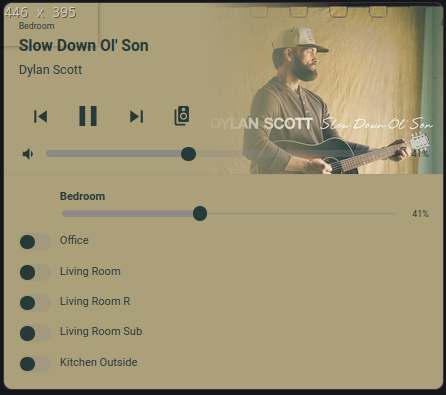

# Homeassistant 4Stream Card

A custom Home Assistant Lovelace card for controlling LinkPlay/4stream WiFi speakers with Spotify integration.


## Screenshots

| Player | Speaker Group |
|--------|--------------|
|  |  |

## Features

- Album artwork from Spotify with color-extracted background and adaptive text colors
- Transport controls (play/pause, next, previous) targeting Spotify
- Per-speaker volume control
- Speaker grouping with optimistic UI toggles
- Compact mini bar when idle, full player when active
- Automatic Spotify playback transfer between speakers

## Installation

### Manual

1. Copy `www/asound-card.js` to your Home Assistant `config/www/` directory
2. Add the resource in HA: **Settings → Dashboards → ⋮ → Resources → Add**
   - URL: `/local/asound-card.js`
   - Type: JavaScript Module
3. Restart Home Assistant or reload resources

### SSH

```bash
./install.sh root@your-ha-host /config
```

## Configuration

Add the card to any dashboard:

```yaml
type: custom:asound-media-card
entity: media_player.living_room
source_entity: media_player.spotify_your_username
speakers:
  - media_player.living_room
  - media_player.bedroom
  - media_player.kitchen
  - media_player.office
```

| Option | Required | Description |
|--------|----------|-------------|
| `entity` | Yes | Main speaker entity |
| `source_entity` | No | Spotify media player entity (enables artwork, next/prev, playback transfer) |
| `speakers` | No | List of speaker entities for group management |

## Theme

An optional warm amber theme is included at `themes/asound.yaml`. To use it:

1. Ensure your `configuration.yaml` includes themes:
   ```yaml
   frontend:
     themes: !include_dir_merge_named themes
   ```
2. Copy `themes/asound.yaml` to your `config/themes/` directory
3. Select the theme: **Profile → Theme → ASound**

## Notes

- The LinkPlay/4stream HA integration does not reliably report `group_members`. This card uses the Spotify `source` attribute to supplement speaker state.
- Speaker names may differ between HA and Spotify (e.g. "livingroom" vs "living room") — the card normalizes names automatically.
